# Wokit 工作助手

一个面向个人的轻量工作台：用日历安排每日任务，按周写周报，顺手记备忘、登记工时、盯着计时节点。
后端完全沿用 `D:\Desktop\Smart_Elderly_Care\elder` 智慧养老项目的分层与编码范式（`Result` 统一返回、`ServiceException` + `GlobalExceptionHandler`、MyBatis-Plus 分页、真实删除、自动填充时间），前端为 Vue3 + Element Plus 的浅色企业后台风格。

| 层 | 技术 |
| --- | --- |
| 后端 | Spring Boot 3.4.5 / Java 21 / MyBatis-Plus 3.5.5 / MySQL 8 / JWT / BCrypt |
| 前端 | Vue 3.5 / Vite 6 / Element Plus 2.9 / Pinia 3 / Vue Router 4 / Axios / ECharts 5.6 |
| 视觉 | 主色 `#12B76A`，浅灰画布 `#F4F6F8`，白色圆角卡片 + 细边框，桌面左右布局、移动端自适应 |

## 功能

- **首页看板**：汇总今日待办、本周完成、本月工时、进行中计时四项指标；近 7 天任务新增/完成趋势、本月项目工时构成、近 4 周周报数量使用 ECharts 展示，数据全部来自当前登录账号的真实记录。
- **登录鉴权**：账号密码登录，BCrypt 加密存储，JWT 签发 24 小时有效 Token；除登录接口外全部请求经 `LoginInterceptor` 校验，缺失或失效返回 `401`，前端清理登录态并跳转登录页。
- **用户管理（仅管理员）**：新增平台登录账号、编辑资料、启用/停用、重置密码、分页查询；服务端限制普通用户访问，且不允许停用或删除当前登录账号。
- **每日任务（一期核心）**：月视图日历（切换月份、回到今天、有任务日期打点）、点击日期加载当日截止任务、弹窗新建/编辑、勾选完成、删除；截止时间早于开始时间由后端与前端双重拦截。
- **周报记录**：按周切换查看（上一周 / 下一周 / 本周），每条记录包含任务内容、结果、存在的问题、产出、其他；支持新建、编辑、删除，并可一键把本周全部明细导出为 `.txt` 文本，未填写的字段不输出。
- **扩展工具**：备忘录（彩色标记、置顶、搜索）、工时登记（按月统计本月工时/登记天数/日均工时）、计时（倒数日、正数日、精准倒计时，数据库存储）。
- **计时模式**：倒数日显示距目标还有几天，目标日过后自动转为正数日；正数日显示目标已经过去几天；精准倒计时按分钟设置目标，实时显示剩余的天、小时、分钟、秒，到点后自动结束并显示「已到时间」。

## 快速启动

### 1. 数据库

MySQL 8.x，执行建库脚本（脚本内已包含建表与演示数据）：

```bash
mysql -uroot -p < sql/wokit.sql
```

默认连接 `localhost:3306/wokit`，账号 `root / 1234`。如与本机不同，改 `src/main/resources/application.yml`，或用环境变量覆盖：

```bash
SPRING_DATASOURCE_USERNAME=root
SPRING_DATASOURCE_PASSWORD=1234
```

### 2. 后端

需要 JDK 21 + Maven：

```bash
mvn -DskipTests package
java -jar target/wokit-0.0.1-SNAPSHOT.jar
# 或开发模式：mvn spring-boot:run
```

服务地址 `http://localhost:8080`。

### 3. 前端

```bash
cd ui/ui-admin
npm install
npm run dev          # http://127.0.0.1:5173
npm run build        # 产物在 dist/
```

Vite 已配置代理：`/admin/api` → `http://localhost:8080/admin`，本地开发无需处理跨域。

### 4. 演示账号

| 账号 | 密码 | 角色 | 说明 |
| --- | --- | --- | --- |
| `admin` | `123456` | 管理员 | 可见用户管理、全部工具 |
| `demo` | `123456` | 普通用户 | 仅工作台工具，无用户管理入口 |

## 目录结构

```
wokit
├─ sql/wokit.sql                    建库建表 + 演示数据
├─ src/main/java/cn/tinsur/wokit
│  ├─ config/                       WebConfig、MybatisPlusConfig、MyMetaObjectHandler
│  ├─ controller/admin/
│  │  ├─ user/UserController.java
│  │  ├─ task/TaskController.java
│  │  ├─ dashboard/DashboardController.java
│  │  └─ tool/{MemoController,WorkLogController,WeeklyController,TimerItemController}.java
│  ├─ exception/                    ServiceException、GlobalExceptionHandler
│  ├─ interceptor/LoginInterceptor.java
│  ├─ mapper/                       User/Task/Memo/WorkLog/Weekly/TimerItem Mapper
│  ├─ pojo/{entity,dto,query,vo}    实体、入参、查询条件、出参
│  ├─ service/impl/                 业务实现
│  └─ util/                         Result、JwtUtil、PasswordUtil、AuthUtil
└─ ui/ui-admin
   ├─ src/api/                      按模块封装的接口
   ├─ src/components/               StatCard、EmptyState、EChart
   ├─ src/router/                   路由与登录/角色守卫
   ├─ src/store/                    token、userInfo（Pinia 持久化）
   ├─ src/utils/request.js          Axios 实例，统一 Token 与 401
   └─ src/views/                    Login、Layout、Dashboard、Task、Weekly、User、Memo、WorkLog、Timer
```

## 接口一览

统一前缀 `/admin`，响应结构 `{ code, msg, data }`，`code = 1` 成功、`0` 失败。
除登录外均需请求头 `Authorization: <token>`。

| 方法 | 路径 | 说明 |
| --- | --- | --- |
| POST | `/admin/users/login` | 登录，返回 Token 与用户信息 |
| GET | `/admin/users/userInfo` | 当前登录用户 |
| GET | `/admin/dashboard` | 首页看板汇总数据 |
| GET | `/admin/users?page&limit&name&status` | 用户分页 |
| POST | `/admin/users` | 新增账号 |
| PUT | `/admin/users/{id}` | 编辑账号 |
| PUT | `/admin/users/status/{id}?status=0\|1` | 启用 / 停用 |
| PUT | `/admin/users/password` | 修改当前账号密码 |
| DELETE | `/admin/users/{id}` | 删除账号（真实删除） |
| POST | `/admin/tasks` | 新建任务 |
| GET | `/admin/tasks/{id}` | 任务详情 |
| PUT | `/admin/tasks/{id}` | 修改任务 |
| DELETE | `/admin/tasks/{id}` | 删除任务 |
| PUT | `/admin/tasks/status/{id}?status=0\|1` | 切换完成状态 |
| GET | `/admin/tasks/date?date=YYYY-MM-DD` | 某日截止的任务 |
| GET | `/admin/tasks/calendar?month=YYYY-MM` | 月历任务打点 |
| GET | `/admin/tasks/stat` | 今日 / 本周 / 本月统计 |
| GET | `/admin/weeklies?weekStart=YYYY-MM-DD` | 某一周的周报明细 |
| POST | `/admin/weeklies` | 新增周报记录 |
| PUT | `/admin/weeklies/{id}` | 修改周报记录 |
| DELETE | `/admin/weeklies/{id}` | 删除周报记录 |
| GET/POST | `/admin/memos` | 查询 / 新增备忘 |
| PUT/DELETE | `/admin/memos/{id}` | 修改 / 删除备忘 |
| PUT | `/admin/memos/pin/{id}` | 置顶 / 取消置顶 |
| GET/POST | `/admin/worklogs` | 查询 / 新增工时 |
| PUT/DELETE | `/admin/worklogs/{id}` | 修改 / 删除工时 |
| GET | `/admin/worklogs/stat?month=YYYY-MM` | 月度工时统计 |
| GET/POST | `/admin/timers` | 查询 / 新增计时 |
| PUT/DELETE | `/admin/timers/{id}` | 修改 / 删除计时 |

## 数据表

- `sys_user`：账号、密码（BCrypt）、姓名、手机、邮箱、头像、角色（1 管理员 / 0 普通）、状态、创建与更新时间。
- `work_task`：所属用户、标题、描述、开始时间、截止时间、状态（0 待完成 / 1 已完成）、时间戳。
- `work_memo`：所属用户、内容、颜色标记、置顶标记、时间戳。
- `work_log`：所属用户、工作日期、项目、工作内容、工时（`DECIMAL(5,1)`）、时间戳。
- `work_weekly`：所属用户、周起始日（周一）、周结束日（周日）、任务内容、结果、存在的问题、产出、其他补充、时间戳。
- `work_timer`：所属用户、计时名称、模式（`countdown_day` / `countup_day` / `precise`）、目标时间、时间戳。

## 关键约定

- 任务只能由创建者本人查看、修改、删除；周报记录同样按 `userId` 校验归属；用户管理仅 `role = 1` 可访问。
- 截止时间不得早于开始时间，Service 层抛 `ServiceException("截止时间不能早于开始时间")`。
- 周报记录写入时统一把周起始日归一到周一，并自动补齐周结束日；任务内容必填，其余字段选填。
- 被停用账号不能登录；管理员不能停用或删除自己。
- 计时记录按用户隔离；倒数日目标日不能早于今天，正数日目标日不能晚于今天，精准倒计时目标时间需晚于当前时间。
- 全库不设逻辑删除字段，所有删除接口都直接执行物理删除；`create_time / update_time` 由 `MyMetaObjectHandler` 自动填充。
- 前端 `request.js` 遇到 401 统一清理 Token、提示并跳转登录，避免并发请求重复弹窗。

## 页面预览

| 首页看板 | 首页移动端 |
| --- | --- |
| 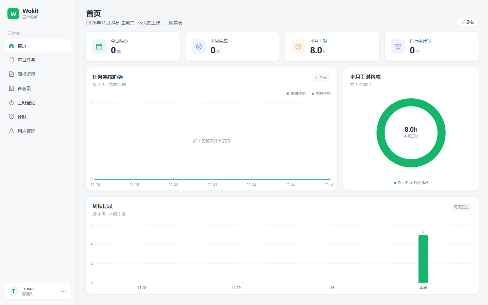 | 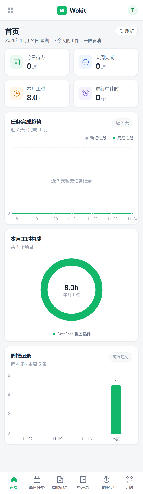 |

| 登录 | 每日任务 |
| --- | --- |
| 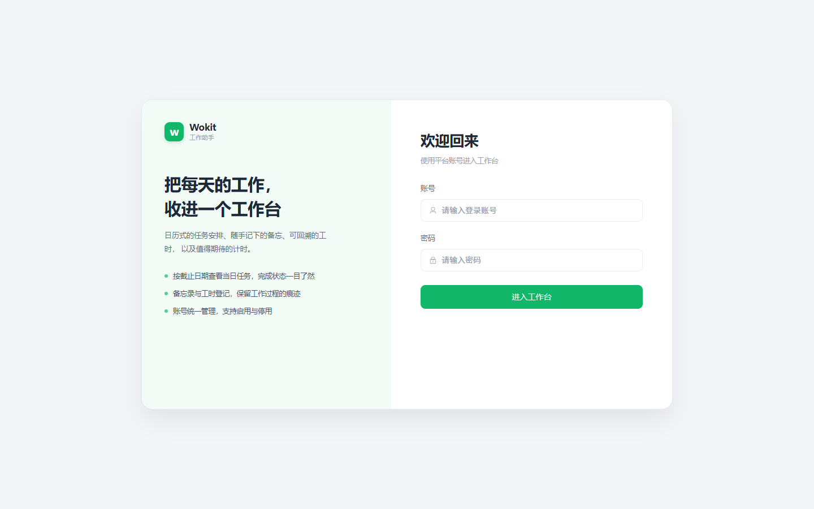 | 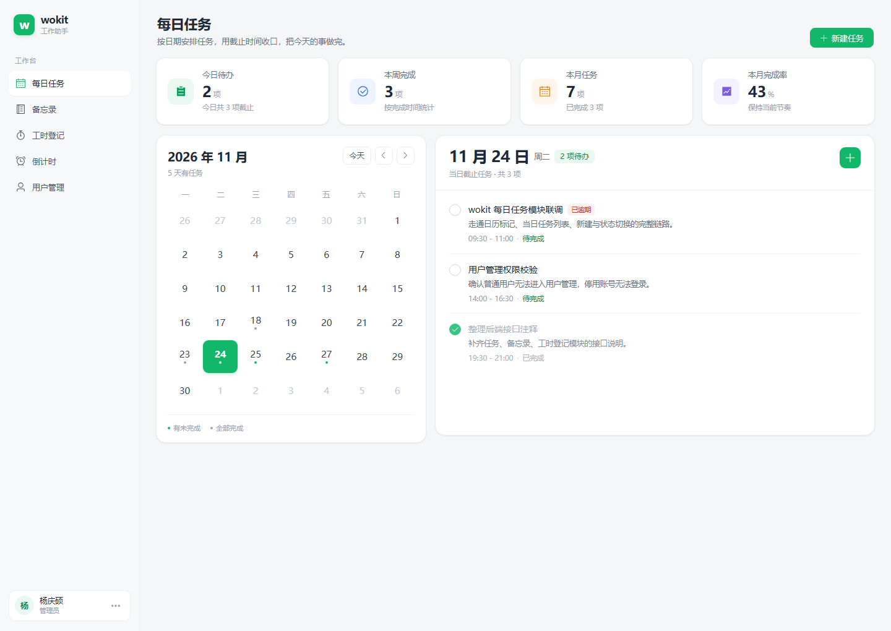 |

| 新建任务弹窗 | 用户管理 |
| --- | --- |
| 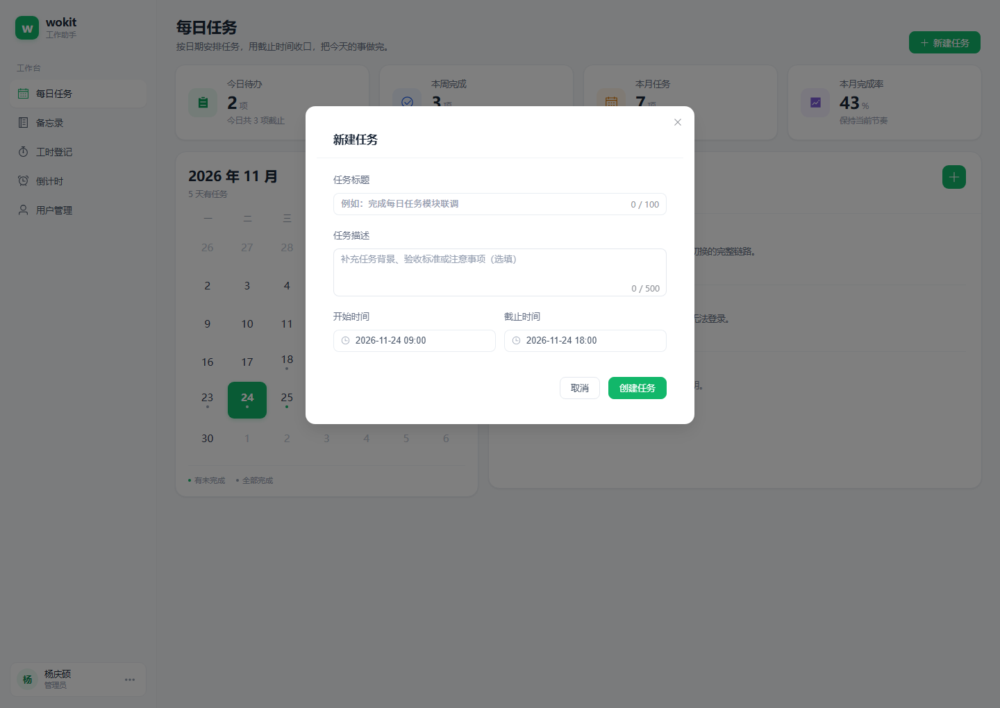 | 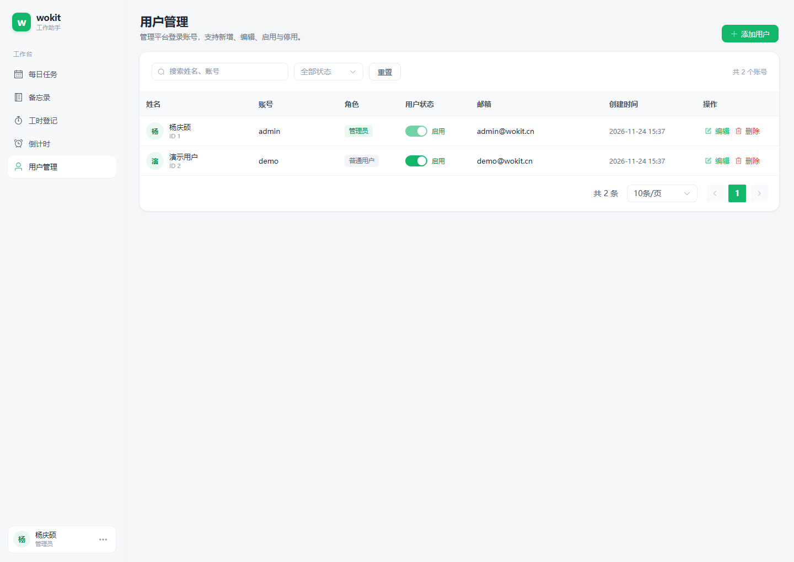 |

| 备忘录 | 工时登记 |
| --- | --- |
| 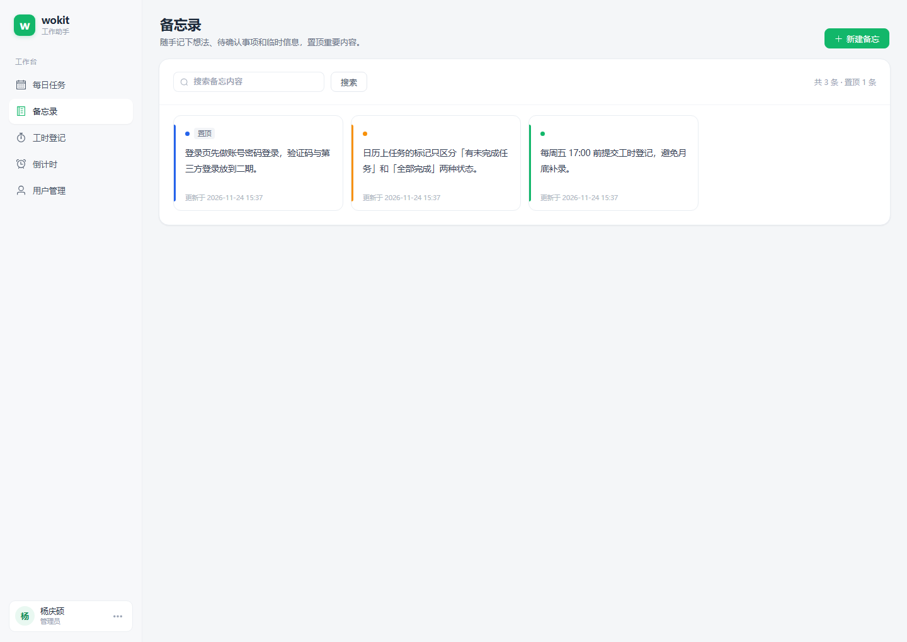 | 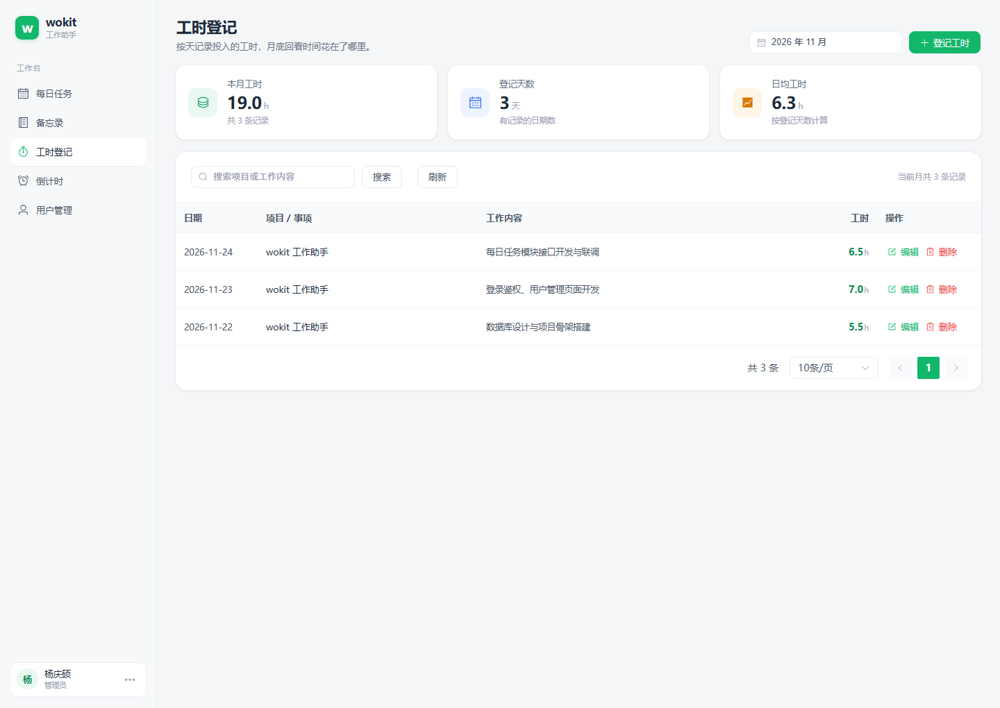 |

| 计时 | 新建计时 |
| --- | --- |
| 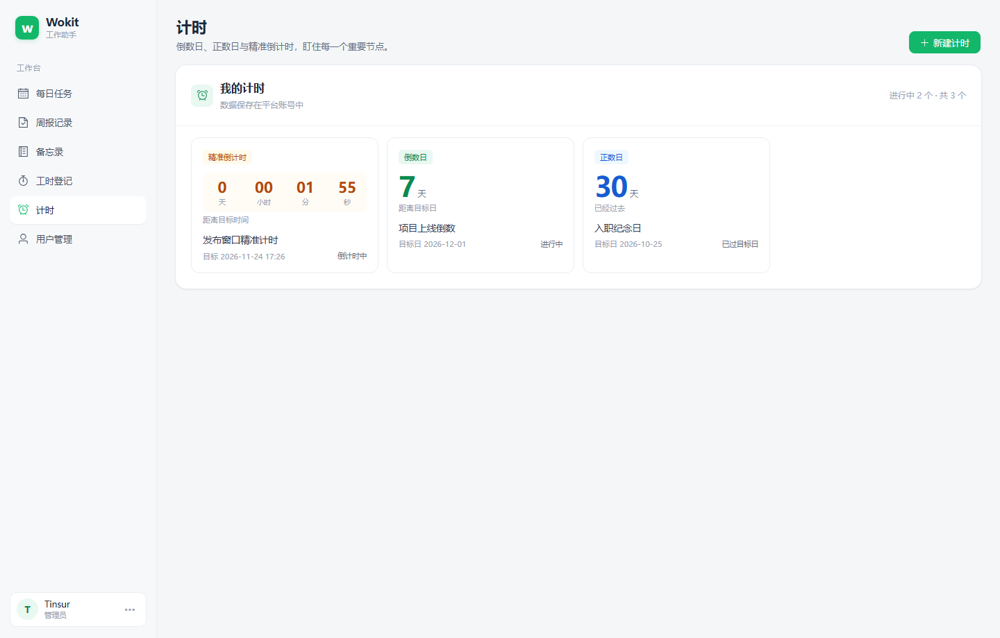 | 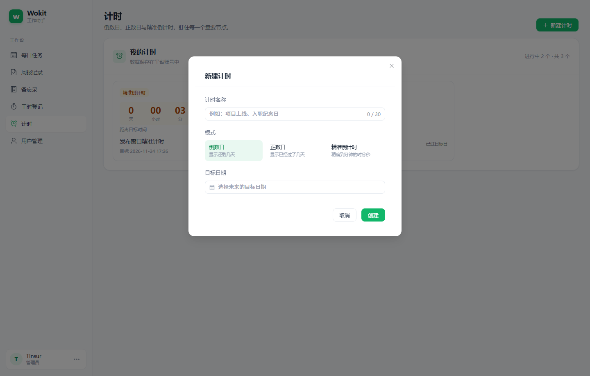 |

| 计时移动端 |
| --- |
| 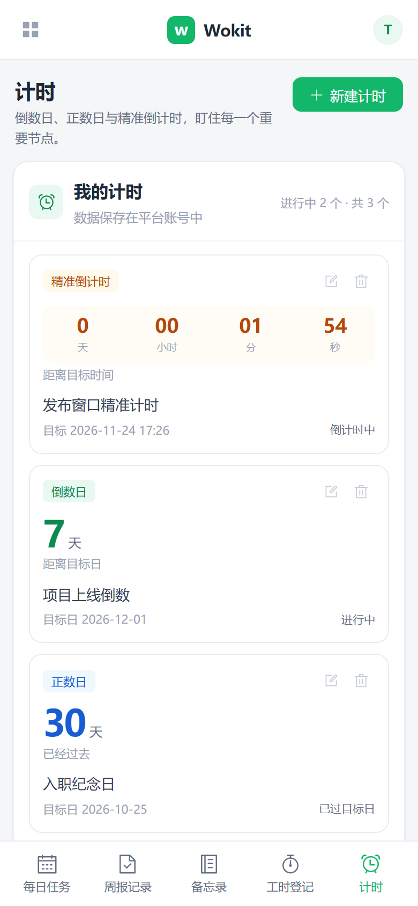 |

| 周报记录 | 新建周报 |
| --- | --- |
| 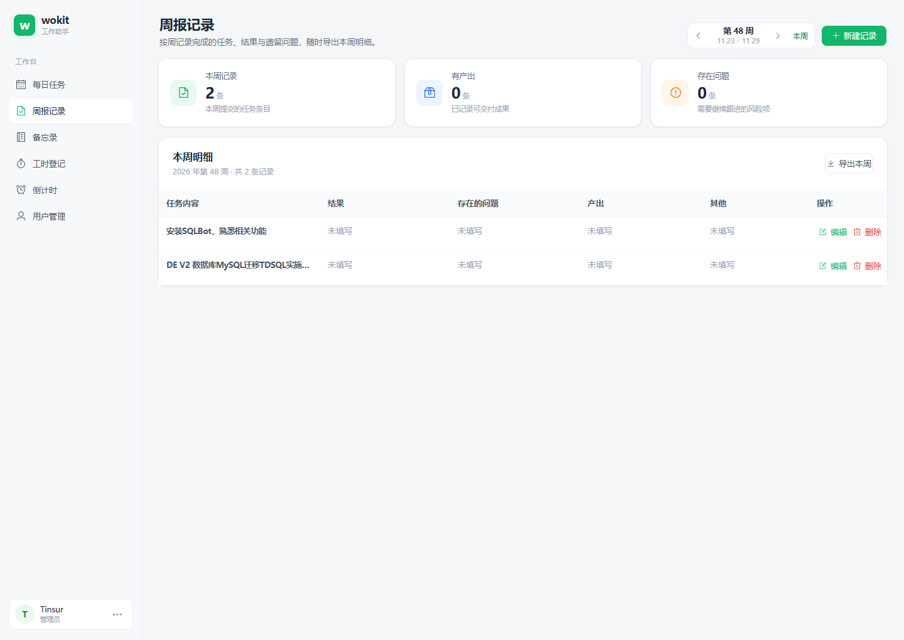 | 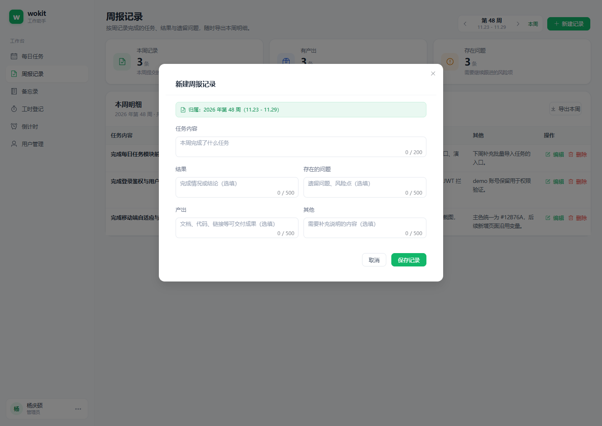 |

| 周报移动端 |
| --- |
| 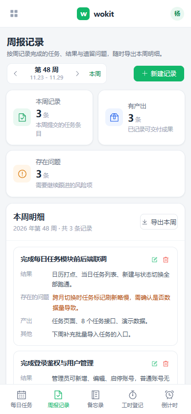 |
